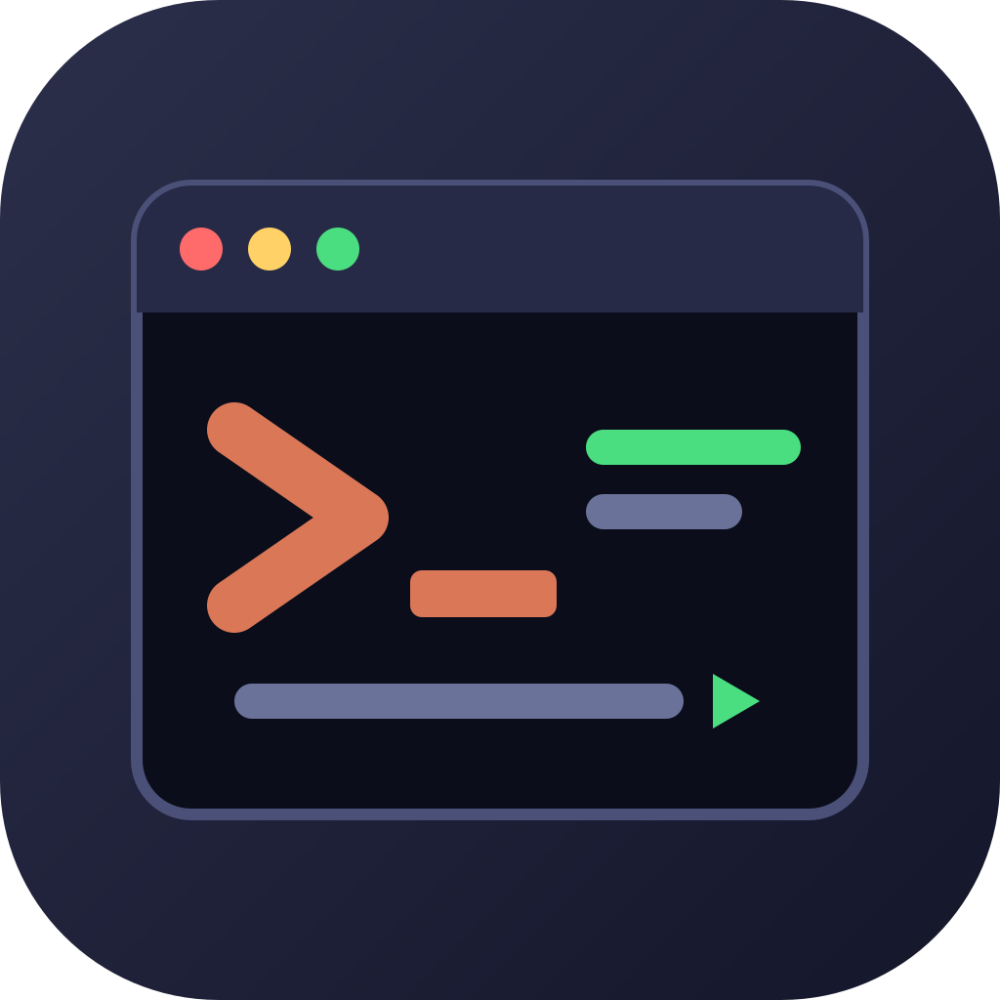

<p align="center">
  
</p>

<h1 align="center">run-pane</h1>

<p align="center">
  Run dev servers, test watchers and other commands in a Run pane beside your Claude Code chat,<br>
  and let Claude read what they print.
</p>

## What you get

- **A Run pane.** Start a command, watch its output live while you keep chatting, and stop it cleanly when you are done.
- **Claude can see the output.** Ask "why did the server crash?" and Claude reads what is on your screen.
- **One-click suggestions.** The pane offers the scripts it finds in your project (`npm run dev`, `cargo test`, `make build`, ...).
- **A shell on demand.** `/shell` opens a shell in the session's folder: a terminal pane beside Claude Code in herdr or tmux, a terminal window on macOS.
- **Runs in your multiplexer.** Started inside [herdr](https://herdr.dev) or tmux, `/rp` runs each command in a terminal pane of its own beside Claude Code, where you can click in and type to it.

## Quick start

1. Install it (see [Install](#install)).
2. Type `/rp npm run dev` (or any command) at the prompt.
3. Watch it run in the Run pane. Press **Stop (Ctrl+C)** when you are finished.

| Command | What it does |
| --- | --- |
| `/rp <command>` | Runs the command in the Run pane. |
| `/rp` | Opens the Run pane. |
| `/rp close` | Closes the Run pane. Runs keep going. |
| `/shell` | Opens a shell in the session's folder: a pane in herdr or tmux, else a terminal window (macOS). |

`/rp` is a slash command, so it never reaches Claude and the prompt box clears by itself.

## Install

At the prompt of a terminal session:

```
/plugin install run-pane --marketplace jaichandra/run-pane
```

Or from a shell:

```
claude plugin install run-pane --marketplace jaichandra/run-pane
```

Answer `y` to add the marketplace, then pick a scope (the first, user scope, keeps it on in every session). It is active in the current session at once.

**Desktop app** (where `/plugin` does not run): click **+** next to the prompt box, then **Plugins**, **Add marketplace** with `jaichandra/run-pane`, then **Add plugin**.

### Requirements

- Works in the terminal (CLI) session, which is where it is known to work. `/rp` tells you when it cannot place the Run pane.
- **Turn on the flicker-free display mode** (Claude Code calls it [fullscreen rendering](https://code.claude.com/docs/en/fullscreen)). The Run pane is built for it: it docks on the right of the chat (from about 110 columns wide) and its buttons work, because the mode adds mouse support. It is not a maximised window: a normal-sized window works. Without it the pane sits below the chat as a limited view and its buttons may not respond. Some setups start with it on (iTerm, Terminal.app) and some with it off (a plain Debian terminal, or a saved `"tui": "default"` setting). To turn it on, run `/tui fullscreen` in the session (it relaunches with your conversation intact and saves the choice), or start Claude Code with `CLAUDE_CODE_NO_FLICKER=1 claude`. `/rp` and the Run pane itself show a red notice, with a link to those docs, whenever it is in the limited view.
- `/rp` runs commands through `sh`, `ps` and `kill`: macOS and Linux, not Windows.
- `/shell` needs herdr or tmux, or macOS (Terminal or iTerm).

## Using it

### The Run pane

`/rp` opens the Run pane and gives it the keyboard. From top to bottom it shows:

- the folder's name;
- a command field, `$ `: type a command and press Enter;
- **Suggestions**, one button each (press to run): `npm run <script>` for every script in the folder's `package.json` (`dev`, `start`, `serve`, `watch`, `test`, `build` and `lint` first), `cargo run` and `cargo test` where there is a `Cargo.toml`, and `make <target>` for each plain target of a `Makefile`; ten at most;
- the runs, newest last: `●` running, `✓` exited with 0, `✗` exited with an error or could not start, `■` stopped; press one to see its output;
- the output of the selected run, the last 2,000 lines of it, coloured with your theme: URLs underlined, `# notes` dimmed, `▶` banners green, command lines (`npm`, `docker`, `make`, `git`, ...) and warnings in the warning colour, errors in the error colour, headings that end in a colon bold. A line a progress bar keeps redrawing shows its last state;
- one row of buttons, last, so it stays in view while the Run pane follows the output (End brings the following back after you scrolled up).

The buttons:

| Button | What it does |
| --- | --- |
| Stop (Ctrl+C) | Ends the selected run the way a terminal would: Ctrl+C (SIGINT) to its shell and everything below it, then SIGTERM after 30 s, then SIGKILL after another 10 s, if it has not ended. While it is stopping the button reads **Force kill**, which skips the waiting. |
| Restart | Runs a finished run's command again. |
| Clear | Empties the selected run's output. |
| Remove | Takes a finished run off the list. |
| End | Scrolls the Run pane to its last row and follows new output again. |
| Shell | The same as `/shell`. |
| Close pane | Closes the Run pane. Esc does the same. Runs keep going. |

Commands run through `sh -lc` (a login shell, so `/etc/profile` and `~/.profile` apply) in the folder the session is in. The Run pane scrolls as a whole (mouse wheel, or the keys while it has the focus), follows new output while it is scrolled to the bottom, and stays where you left it once you scroll up; End brings the following back. With the pane focused, Tab and the arrow keys walk its buttons, and Esc closes it.

The list holds 12 runs at most; the oldest finished ones drop off first. Runs still going when the session ends are stopped the same way Stop does it.

### In herdr and tmux

When Claude Code runs inside [herdr](https://herdr.dev) (`HERDR_ENV=1`) or tmux (`$TMUX`), the plugin notices and uses it, with no setting. herdr is checked first.

- `/rp <command>` types the command into the pane of the last run if nothing is running in it (none of this plugin's runs, no command of yours in front of the prompt, and no background job such as `while true; do ./x.sh; sleep 1; done &` behind it, since that prints into the pane; jobs are looked for with `pgrep`, and a shell with helper processes of its own, like some prompt themes, counts as busy). Otherwise, or for the first run, it splits a new terminal pane (the first on the right of Claude Code, the next ones below the last) and types it there. It then follows what the pane shows. Your focus stays where it was. The terminal pane is a real terminal: click into it to answer a prompt or use an editor. `/rp <command>` leaves the Run pane shut, since the command is already in front of you; `/rp` alone opens it, listing the runs with their output, and `run_output` returns them to Claude as before.
- Stop types Ctrl+C into the terminal pane; if the command ignores it for 30 s, or Force kill is pressed, the pane is closed. A finished run's pane stays open, so you can read it and the next command can use it. Remove closes it unless another run's output is on it too. Restart types the command again, in the same pane if it is free. Closing a pane yourself ends its run as stopped.
- The command is typed into the pane exactly as you would type it, so the pane is your own shell with its history: prompt, command, result, and the earlier ones above. Your aliases and shell setup apply. The Run pane knows the command is over when the pane's shell is back at its prompt, and then marks the run `done` (○): a shell does not tell its exit code, so there is no `exit N` here. A command of several lines is not typed into a pane (it would run line by line); it runs as before.
- When you leave the session (`/exit`, Ctrl+C or Ctrl+D), every pane the plugin opened, for runs and for `/shell`, is closed at once, and what runs in them ends with them (Claude Code gives an exit about a second, so they are not asked to stop first). A `/clear` keeps them.
- If a pane cannot be made, the command runs as before, as a process of the plugin, so `/rp` never stops working because of the multiplexer.
- The output is read back about twice a second and holds the last 2000 lines.
- To turn this off, set `"multiplexer": false` in `hooks/run-pane.json` (see below).

### `/shell`

In herdr or tmux, `/shell` splits a terminal pane on the right of Claude Code in the session's folder and focuses it. Anywhere else on macOS it opens a new window with a shell already in the session's folder, titled with the folder's name: iTerm if `/Applications/iTerm.app` exists and Terminal.app otherwise. The first time, macOS may ask whether Claude Code may control that app; if you say no, or anything else goes wrong, `/shell` says why in one line.

Elsewhere `/shell` says so and does nothing. The folder (for the macOS window) is handed to AppleScript as an argument and quoted by AppleScript itself, never pasted into the script, so a name with quotes, spaces, backslashes, `$(...)` or a leading dash is just a name. A folder name that holds a control character (a newline, an escape) is refused, because typed into a terminal it would act as a key.

### `run_output`

A tool for Claude, not for you: `mcp__run-pane__run_output`. It returns the last lines of a run (60 by default, 500 at most) with its status. Give `run` as the run's number or a part of its command; with none, the newest run. Claude sees a run's output only when it calls this tool.

## Optional: `hooks/run-pane.json`

The mod needs no configuration. If you bundle it into your own tooling you can drop a `hooks/run-pane.json` next to `hooks/register.tsx` (a copy installed from this repository has none):

```json
{
  "suggestions": ["make dev", "docker compose up"],
  "openFor": ["acme"],
  "multiplexer": false
}
```

- `suggestions`: commands to suggest before the ones found in the folder.
- `multiplexer`: `false` keeps `/rp` out of herdr and tmux panes, so it runs commands as processes of the plugin even inside them. `/shell` keeps using them.
- `openFor`: words that make the pane open by itself, without taking the keyboard, when the folder's git remote (`origin`) or its path contains one of them (case does not matter; a linked worktree shares its repository's remote, so it counts). Anywhere else the pane waits for `/rp`.

Both are optional. A missing or unreadable file means the defaults.

## Development

The mod is a hooks module in TypeScript with no build step:

| Path | What is in it |
| --- | --- |
| `.claude-plugin/plugin.json`, `.claude-plugin/marketplace.json` | The manifest, and the marketplace file that makes this repository installable. |
| `hooks/register.tsx` | The commands, the tool, the pane and the processes. |
| `hooks/run.ts` | Logic with no engine in it: the output log, colouring, suggestions, the process tree. |
| `hooks/shell.ts` | The AppleScript for `/shell` and the words it answers with. |
| `hooks/mux.ts` | Logic with no engine in it for herdr and tmux: telling which one it is, the pane commands, telling a pane's output from the command typed into it, and whether its shell is at the prompt. |
| `types/index.d.ts` | The pane's state, declared for the engine. |
| `tests/` | Tests: `run.test.ts`, `shell-script.test.ts` and `mux.test.ts` for the logic, `pane.test.tsx`, `shell.test.tsx` and `mux-pane.test.tsx` for the mod running against a stand-in engine. |

```
claude plugin validate .      # the manifest, the marketplace file and what the hooks module calls
claude plugin test .          # the tests, against the engine
claude --plugin-dir .         # try it in a session, reloading when a file is saved
```

The tests never open a terminal, run osascript or start herdr or tmux: `process.run` is answered by a stub.

To type-check, use a `tsconfig.json` like the one in the header of the engine's API types, which the engine writes to `.claude-plugin/types/` when it loads the mod from a folder (that folder is git-ignored):

```json
{
  "compilerOptions": {
    "target": "es2023", "lib": ["es2023"], "types": [],
    "module": "esnext", "moduleResolution": "bundler",
    "strict": true, "noUncheckedIndexedAccess": true,
    "noEmit": true, "skipLibCheck": true,
    "jsx": "react", "jsxFactory": "h", "jsxFragmentFactory": "Fragment"
  },
  "include": [".claude-plugin/types", "hooks", "types", "tests"]
}
```

then `tsc -p tsconfig.json` (TypeScript 5.4 or newer).

## License

MIT, see [LICENSE](LICENSE).
